# Assignment 3. Responsive Web Design (Media Queries + Bootstrap Grid)

**Name:** Almansur Maxym
**Group:** IT-2501

## Project structure

- `index.html` – one page with all tasks (Part 1, Part 2, Part 3)
- `style.css` – custom styles and media queries
- `screenshots/` – screenshots for the report

Breakpoints used in the project: **mobile** < 768px, **tablet** 768px – 991px, **desktop** ≥ 992px.

---

## Part 1. Media Queries

### Task 0. Responsive Typography
Create a simple webpage with headings and paragraphs. Use media queries to change font sizes for mobile, tablet, and desktop.

**Mobile**
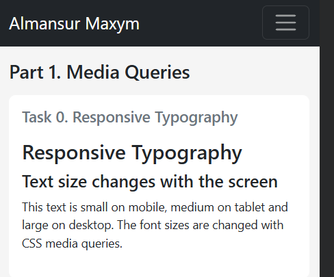

**Tablet**
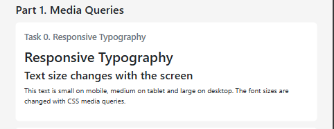

**Desktop**
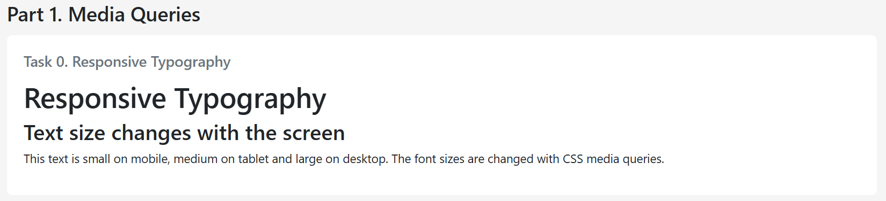

### Task 1. Responsive Layout with Media Queries
Create a webpage with three boxes in a row. On desktop: all three side by side. On tablet: two boxes in a row. On mobile: boxes stacked vertically. Only CSS media queries (no Bootstrap).

**Mobile**
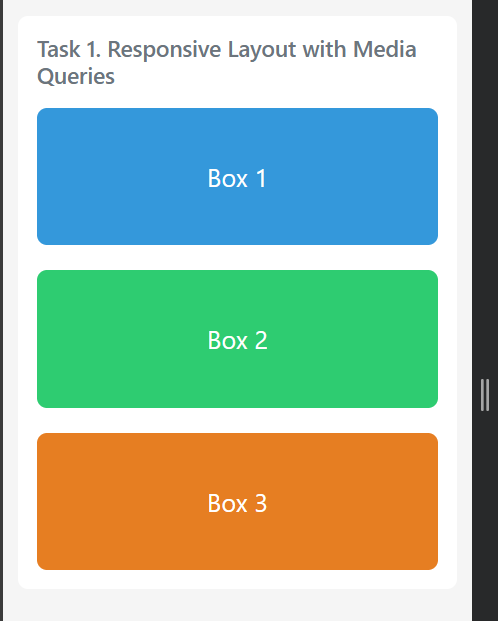

**Tablet**
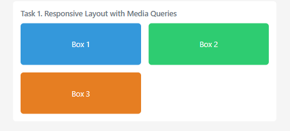

**Desktop**
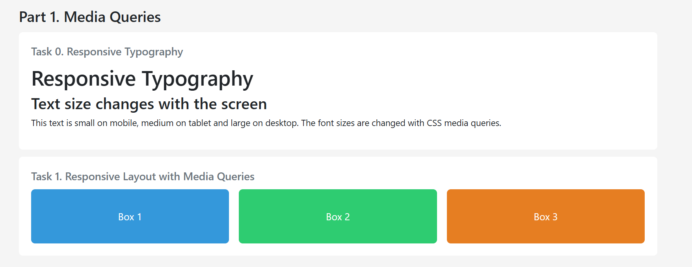

---

## Part 2. Bootstrap Grid System

### Task 2. Bootstrap Responsive Columns
Build a responsive layout using Bootstrap's 12-column grid with three columns. On desktop: each column takes 4 columns. On tablet: two columns on the first row and one on the second row. On mobile: all columns stacked.

**Mobile**
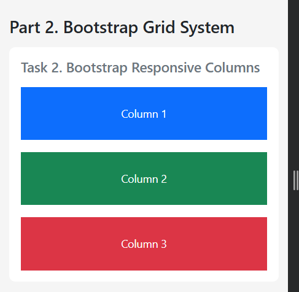

**Tablet**
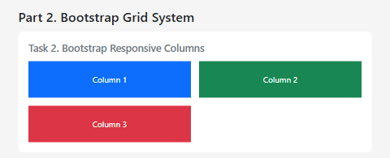

**Desktop**
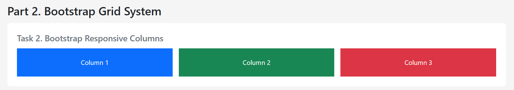

### Task 3. Bootstrap Navigation Bar
Create a responsive navigation bar with a logo on the left, links on the right, which collapses into a hamburger menu on smaller screens.

**Desktop**
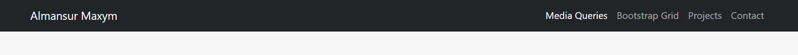

**Mobile (menu closed)**
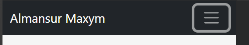

**Mobile (menu opened)**
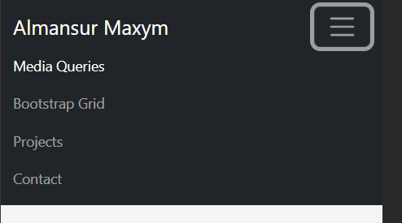

---

## Part 3. Combined Project

### Task 4. Responsive Portfolio Page
Create a portfolio page using both Media Queries and Bootstrap Grid: header with a Bootstrap navbar, main section with projects on the left and a sidebar with personal info and contacts on the right, and a footer. Custom media queries adjust font sizes, spacing and element visibility.

**Desktop**
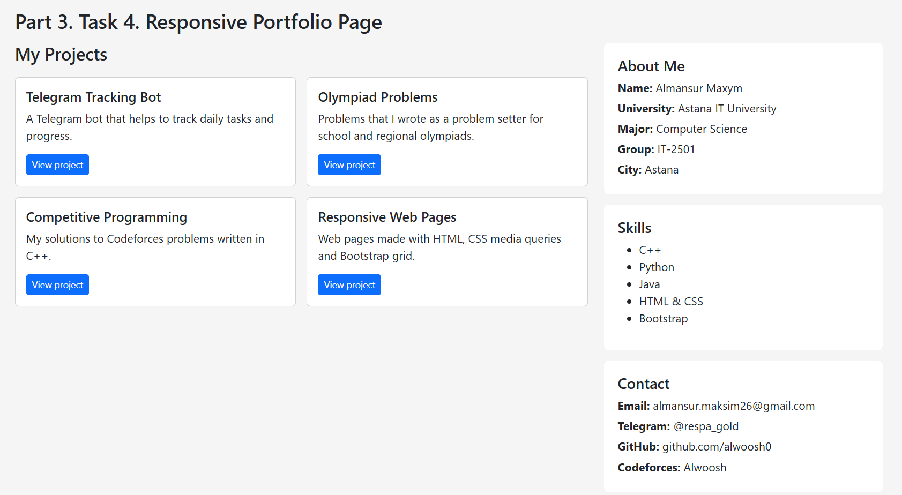

**Tablet**
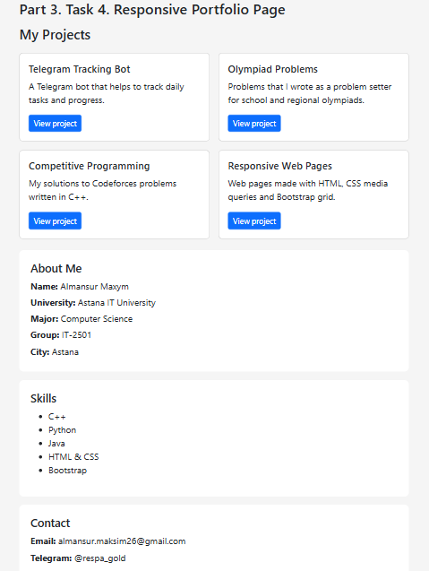

**Mobile**
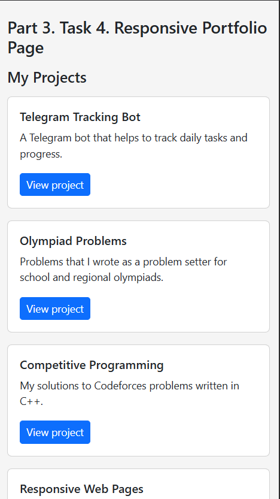

---

## Summary of work process

I made one website (index.html and style.css) that contains all tasks. First I wrote the styles for mobile screens, and then I used media queries to change the styles for tablet (from 768px) and desktop (from 992px).

In Part 1, I used only my own CSS without Bootstrap. In Task 0, media queries change the font sizes of the headings and the paragraph. In Task 1, media queries change the layout of three boxes: on mobile they are stacked, on tablet there are two boxes in a row, and on desktop all three are side by side.

In Part 2, I connected Bootstrap. In Task 2, I used the Bootstrap grid, so the three columns are stacked on mobile, two per row on tablet and three per row on desktop. The navigation bar at the top of the page is Task 3: the logo is on the left, the links are on the right, and on smaller screens the links collapse into a hamburger menu.

In Part 3, I made a portfolio section using both Bootstrap grid and my own media queries. On desktop, the projects are on the left and the sidebar with my info and contacts is on the right. On smaller screens, the sidebar moves below the projects. My media queries change font sizes and spacing, and hide the Skills block on mobile. The page also has a header with the navigation bar and a footer at the bottom.

I tested the page in Chrome DevTools at mobile, tablet and desktop widths.